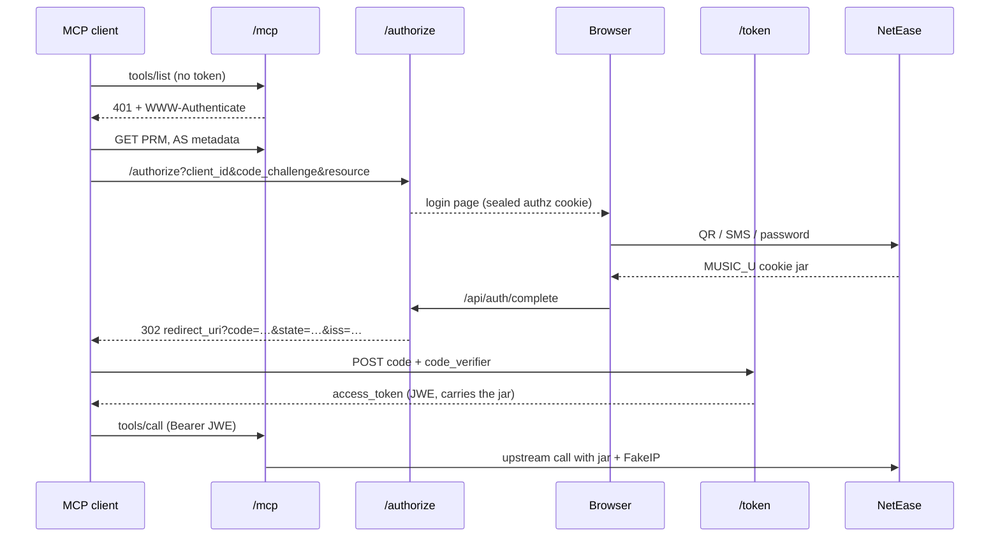

# NeteaseCloudMusic MCP

A **stateless** Model Context Protocol server for the [NeteaseCloudMusicApiEnhanced/api-enhanced](https://github.com/NeteaseCloudMusicApiEnhanced/api-enhanced) project, designed to run on Vercel. It is its own OAuth 2.1 authorization server: your MCP client registers itself, opens a login page where you scan a QR code (or use an SMS code or password), and the resulting NetEase session is sealed inside the MCP access token.

Because the session lives in the token rather than in a database, **this deployment stores no user data at rest.** Any instance can serve any request.

- 86 curated tools across 8 toolsets, plus `ncm_raw` for any of the 451 underlying endpoints
- QR / SMS / password sign-in, all through the same OAuth flow
- PKCE (S256), RFC 9728 protected resource metadata, RFC 8414 authorization server metadata
- Client ID Metadata Documents (CIMD) and stateless dynamic client registration
- Client IP forwarded to NetEase as the per-caller "FakeIP"

---

## How it works



Every piece of state is a compact JWE (`dir` + `A256GCM`) sealed with `NCM_TOKEN_SECRET`:

| Token | Lifetime | Contents |
| --- | --- | --- |
| authz request cookie | 10 min | client, redirect URI, scope, PKCE challenge, state |
| authorization code | 60 s | the above + the sealed NetEase cookie jar |
| access token | 1 h | scope, cookie jar, uid, session expiry |
| refresh token | 30 d | same, extendable up to `NCM_SESSION_MAX_AGE_SECONDS` |
| client id (DCR) | 1 y | redirect URIs, client name, grant types |

---

## Deploy

```bash
npm install
npm run build
```

Set these in the Vercel project, then deploy:

| Variable | Required | Notes |
| --- | --- | --- |
| `NCM_TOKEN_SECRET` | yes | 16+ chars; `openssl rand -base64 32` |
| `NCM_TOOLSETS` | no | e.g. `search,music,discover`; default `all` |
| `MCP_PUBLIC_ORIGIN` | no | only for a custom domain |
| `NCM_FALLBACK_RANDOM_CN_IP` | no | see [FakeIP](#fakeip) |

`vercel.json` pins the `hkg1` / `sin1` regions, which keeps NetEase latency low.

---

## Connect a client

Point the client at `https://<your-deployment>/mcp`. Nothing else is needed: the server answers `401`, and the client discovers the rest.

The landing page, the login page and the OAuth/login error messages follow the browser's `Accept-Language` (`en` and `zh-CN`). No language framework is involved: a typed dictionary in `lib/i18n/` is resolved per request, an `ncm_locale` cookie wins over the header when present, and unknown languages fall back to English.

`GET /healthz` is an unauthenticated liveness probe for uptime monitors. It returns `{"status":"ok","uptime":…,"version":…}` and deliberately touches neither NetEase cookies nor the upstream API, so it stays green while NetEase is unreachable.

**Claude Code / Cursor / VS Code** — add an HTTP MCP server:

```json
{
  "mcpServers": {
    "netease-cloud-music": {
      "type": "http",
      "url": "https://<your-deployment>/mcp"
    }
  }
}
```

On first use the client opens a browser tab. Sign in, and the tab closes itself. If your client does not support OAuth, drive the flow with the Inspector:

```bash
npx @modelcontextprotocol/inspector --cli https://<your-deployment>/mcp --transport http \
  --method tools/list
```

---

## Tools

| Toolset | Tools | What it covers |
| --- | --- | --- |
| `account` | 10 | login state, profile, listener level, follow counts/lists, VIP, daily check-in, logout |
| `search` | 8 | songs/albums/artists/playlists/MV/user search, cloud index, suggestions, hot searches, lyric search |
| `discover` | 12 | daily recommendations, personalised playlists, toplists, banners, new releases, release calendar |
| `music` | 20 | song detail, play/download URLs, lyrics, similar songs, albums, artists, playlists, MV |
| `library` | 17 | likes, scrobble, recent plays, playlist CRUD, cloud music, download list, listening stats |
| `comments` | 6 | read/post/delete/like/reply on songs, albums, playlists, MV, radio |
| `social` | 10 | follow users, subscribe artists/MV/radio, DMs, activity feed, share |
| `meta` | 3 | `ncm_list_endpoints`, `ncm_raw`, `ncm_about` |

`ncm_raw` reaches all 451 endpoints. Read-only ones are always allowed; everything else needs the `ncm:write` scope, which triggers a step-up authorization challenge.

### Scopes

- `ncm:read` — every read tool. Always granted.
- `ncm:write` — anything that changes account state (likes, playlists, comments, follows). Request it in the authorize call, or let the client step up when a write tool returns `insufficient_scope`.

### FakeIP

The NetEase "FakeIP" here is **the IP your MCP client connected from**, read from `x-forwarded-for` and passed upstream as `realIP` (`X-Real-IP` / `X-Forwarded-For`). Using a stable, plausible client address reduces the chance of tripping region logic, and it keeps a single caller consistent across calls.

`NCM_FALLBACK_RANDOM_CN_IP=true` additionally falls back to a random Chinese IP when no forwarded address is present. Leave it off unless you deliberately want that.

---

## Verification

```bash
# 1. Start locally
NCM_TOKEN_SECRET=$(openssl rand -base64 32) npm run build && npm start

# 2. Full OAuth flow + a live tool call (44 assertions)
npm run e2e

# 3. Every read-only tool once
TOKEN=$(node scripts/oauth-e2e.mjs --print-token | grep ^ACCESS_TOKEN= | cut -d= -f2-)
NCM_SMOKE_TOKEN=$TOKEN npm run smoke
```

`scripts/oauth-e2e.mjs` drives discovery, DCR, PKCE authorize, code exchange, refresh, and authenticated `tools/call`. It uses a synthetic session jar so it runs unattended; set `NCM_E2E_JAR` to a real cookie string to exercise a live account.

### Known upstream limits

Some endpoints refuse anonymous sessions. `npm run smoke` reports these separately:

| Tool | Why |
| --- | --- |
| `ncm_recommend_resource` | requires a signed-in account |
| `ncm_similar_users` | requires a signed-in account |
| `ncm_music_calendar`, `ncm_lyric_mark`, `ncm_user_followeds` | upstream returns 301 for guest sessions |
| `ncm_similar_artists` | occasionally triggers NetEase's human-verification gate |

---

## Security notes

- No database, no session store, no cookies for end users beyond the short-lived sealed authz cookie.
- `Authorization` headers and cookie values are never logged. Upstream failures surface as generic messages.
- Access tokens carry the NetEase jar, so treat them like passwords. Short TTLs (1 h) bound exposure, and rotating `NCM_TOKEN_SECRET` revokes everything at once.
- Authorization codes are stateless, so replay protection is bounded by their 60-second TTL rather than a denylist. A stolen code still needs the PKCE verifier, which never leaves the client.
- The `/authorize` endpoint only accepts a `resource` matching this deployment, and only redirect URIs registered by the client (exact match, plus loopback-any-port per RFC 8252).

---

## Caveats

This proxies the unofficial NetEase Cloud Music API. Use it with an account you own and respect NetEase's terms of service. Endpoints, signatures and risk controls change without notice; the pinned `@neteasecloudmusicapienhanced/api` version is what has been tested.

The service is intended for personal use.
